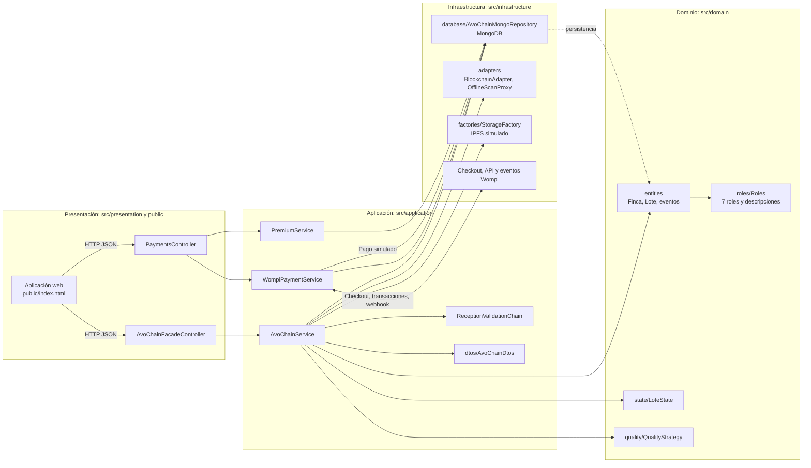
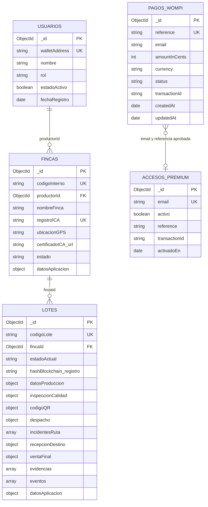
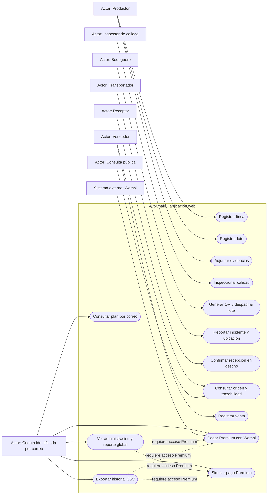

# Diagramas de AvoChain

Diagramas actualizados a la aplicación web y al código actual. El sistema conserva los flujos operativos en Beta y reserva para Premium el panel de Administración, el reporte global y la exportación de trazabilidad. Premium puede activarse mediante una transacción aprobada por Wompi o mediante la pasarela de demostración.

Los bloques Mermaid también están separados para copiarlos como código fuente: [clases](diagramas/clases.mmd), [paquetes](diagramas/paquetes.mmd), [datos](diagramas/datos.mmd) y [casos de uso](diagramas/casos-uso.mmd).

## 1. Diagrama de clases

```mermaid
classDiagram
direction LR

namespace Dominio {
  class Finca {
    +string id
    +string nombre
    +string registroICA
    +string gps
    +string certificadoPdfUrl
    +boolean activa
    +string productorWallet
  }
  class FincaBuilder {
    -Finca finca
    +setId(id) FincaBuilder
    +setNombre(nombre) FincaBuilder
    +setICA(ica) FincaBuilder
    +setGPS(gps) FincaBuilder
    +setCertificado(url) FincaBuilder
    +build() Finca
  }
  class Lote {
    +string id
    +number pesoKg
    +string variedad
    +string fechaCosecha
    +string fincaId
    +LoteEstadoNombre estado
    +string productorWallet
    +string conductorId
    +boolean qrGenerado
    +boolean qrImpreso
    +string txHashRegistro
    +EvidenciaFoto[] evidencias
    +IncidenteRuta[] incidentes
    +EventoTrazabilidad[] eventos
  }
  class InspeccionCalidad {
    +number humedad
    +number temperaturaC
    +string evaluacionFitosanitaria
    +string destino
    +boolean aprobada
    +string informePdfUrl
    +string inspectorId
    +string hashInforme
  }
  class RecepcionDestino {
    +number temperaturaC
    +number cajasDanadas
    +number temperaturaMaximaRutaC
    +string recibidoPor
    +string recibidoEn
  }
  class EvidenciaFoto {
    +string id
    +string filename
    +string mimeType
    +number sizeBytes
    +string url
  }
  class IncidenteRuta {
    +string id
    +string tipo
    +string comentario
    +string conductorId
    +object ubicacion
    +string fotoUrl
    +string creadoEn
  }
  class EventoTrazabilidad {
    +string tipo
    +string actor
    +string fecha
    +string detalle
    +string txHash
  }
  class RolUsuario {
    <<enumeration>>
    Productor
    Bodeguero
    Transportador
    Vendedor
    Administrador
    Inspector de calidad
    Receptor
  }
  class LoteState {
    <<interface>>
    +despachar(context)
    +recibirEnPuntoVenta(context)
    +vender(context)
  }
  class LoteContext {
    -LoteState estado
    +setEstado(estado)
    +getEstadoNombre() LoteEstadoNombre
    +despachar()
    +recibirEnPuntoVenta()
    +vender()
  }
  class EstadoRegistrado
  class EstadoAprobadoCalidad
  class EstadoRechazadoOrigen
  class EstadoEnTransito
  class EstadoEnPuntoVenta
  class EstadoVendido
  class QualityStrategy {
    <<interface>>
    +evaluar(mediciones) boolean
  }
  class ExportQualityStrategy
  class NationalQualityStrategy
  class QRGeneratorSingleton {
    -QRGeneratorSingleton instance
    +getInstance() QRGeneratorSingleton
    +generarQRBase64(idLote) Promise
  }
}

namespace Aplicacion {
  class AvoChainService {
    +registrarFinca(dto)
    +registrarLote(dto)
    +inspeccionarCalidad(idLote,dto)
    +asignarConductor(idLote,dto)
    +confirmarRecepcionDestino(idLote,dto)
    +reportarIncidente(idLote,dto)
    +venderLote(idLote,dto)
    +consultarOrigen(idLote)
    +obtenerDashboard()
  }
  class ReceptionValidationChain {
    +validar(estado,dto)
  }
  class PremiumService {
    +reportes(email)
    +dashboard(email)
    +historialCsv(email,idLote)
  }
  class WompiPaymentService {
    +confirmarPagoDemo(email)
    +crearCheckout(email)
    +estadoPremium(email)
    +verificarRetorno(transactionId)
    +procesarEvento(event)
  }
}

namespace Infraestructura {
  class AvoChainMongoRepository {
    +conectar()
    +guardarFinca(finca)
    +guardarLote(lote)
    +listarFincas()
    +listarLotes()
    +crearOrdenPago(order)
    +actualizarOrdenPago(reference,status,transactionId)
    +activarPremium(email,reference,transactionId)
    +tienePremium(email) boolean
  }
  class PaymentOrder {
    +string reference
    +string email
    +number amountInCents
    +string currency
    +string status
    +string transactionId
    +Date createdAt
    +Date updatedAt
  }
  class BlockchainAdapter {
    +registrarLoteBlockchain(...)
    +despacharLote(...)
    +recibirEnPuntoVenta(...)
    +quemarQrVendido(...)
    +registrarEvento(...)
  }
  class IBlockchainAdapter {
    <<interface>>
  }
  class OfflineScanProxy {
    +escanearQR(idLote,usuario,isOnline)
  }
  class StorageFactory {
    +getProvider(type) StorageProvider
  }
  class StorageProvider {
    <<interface>>
    +uploadImage(buffer,filename) Promise
  }
  class IPFSStorageProvider
}

namespace Presentacion {
  class AvoChainFacadeController
  class PaymentsController {
    +crearCheckout(request,response)
    +confirmarPagoDemo(request,response)
    +estado(request,response)
    +dashboardPremium(request,response)
    +reportes(request,response)
    +exportarHistorial(request,response)
    +webhook(request,response)
  }
  class WebAvoChain {
    <<HTML CSS JavaScript>>
    +roles operativos
    +plan beta o premium
    +panel de administracion
  }
}

FincaBuilder ..> Finca : construye
Lote "*" --> "1" Finca : fincaId
Lote *-- InspeccionCalidad
Lote *-- RecepcionDestino
Lote *-- EvidenciaFoto
Lote *-- IncidenteRuta
Lote *-- EventoTrazabilidad
LoteContext o--> LoteState
LoteState <|.. EstadoRegistrado
LoteState <|.. EstadoAprobadoCalidad
LoteState <|.. EstadoRechazadoOrigen
LoteState <|.. EstadoEnTransito
LoteState <|.. EstadoEnPuntoVenta
LoteState <|.. EstadoVendido
QualityStrategy <|.. ExportQualityStrategy
QualityStrategy <|.. NationalQualityStrategy
AvoChainService --> AvoChainMongoRepository
AvoChainService --> BlockchainAdapter
AvoChainService --> QRGeneratorSingleton
AvoChainService --> ReceptionValidationChain
AvoChainService --> StorageFactory
OfflineScanProxy --> IBlockchainAdapter
BlockchainAdapter ..|> IBlockchainAdapter
StorageFactory ..> StorageProvider
IPFSStorageProvider ..|> StorageProvider
WompiPaymentService --> AvoChainMongoRepository
WompiPaymentService ..> PaymentOrder
PremiumService --> AvoChainMongoRepository
AvoChainFacadeController --> AvoChainService
PaymentsController --> WompiPaymentService
PaymentsController --> PremiumService
WebAvoChain --> AvoChainFacadeController : API REST
WebAvoChain --> PaymentsController : API REST
```

## 2. Diagrama de paquetes

La arquitectura desplegada en este código es una aplicación web Express organizada por capas, con MongoDB y adaptadores. Wompi es un proveedor externo; la pasarela de demostración registra en la misma base una orden `DEMO-` / `SIMULADO-`, sin cobrar. `IAvoChainRepository` existe como contrato de dominio, aunque el servicio de aplicación actual inyecta directamente `AvoChainMongoRepository`.

## 3. Diagrama de datos

MongoDB guarda cinco colecciones. Los lotes almacenan subdocumentos de inspección, despacho, recepción, incidentes, evidencias y eventos; además conservan `datosAplicacion` para reconstruir el objeto del dominio.

Cada lote embebe su historial para mantener la trazabilidad unida al lote. `FINCAS.productorId` y las referencias de productores, inspectores, bodegueros, transportadores, receptores y vendedores apuntan a documentos de `USUARIOS`. `PAGOS_WOMPI` puede contener pagos Wompi o simulados; una orden aprobada activa o actualiza el acceso identificado por correo en `ACCESOS_PREMIUM`. Esta versión todavía no tiene inicio de sesión ni asocia los pagos a una cuenta autenticada.

## 4. Diagrama de casos de uso

En Beta se pueden usar los flujos operativos de finca, lote, inspección, transporte, recepción, consulta y venta. Administración, el reporte global y la exportación requieren acceso Premium, habilitado al verificar una transacción aprobada de Wompi o completar la simulación de pago.
